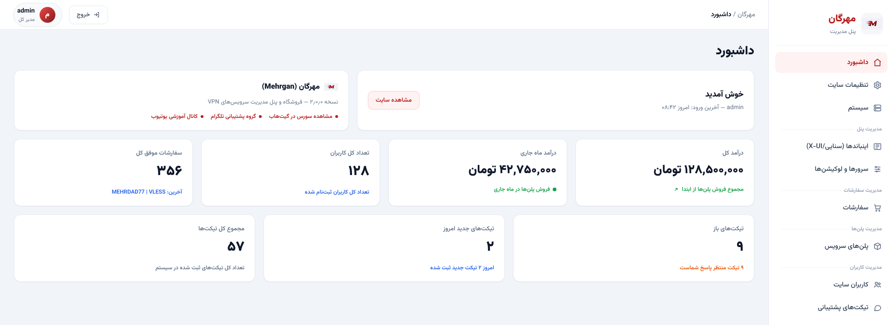
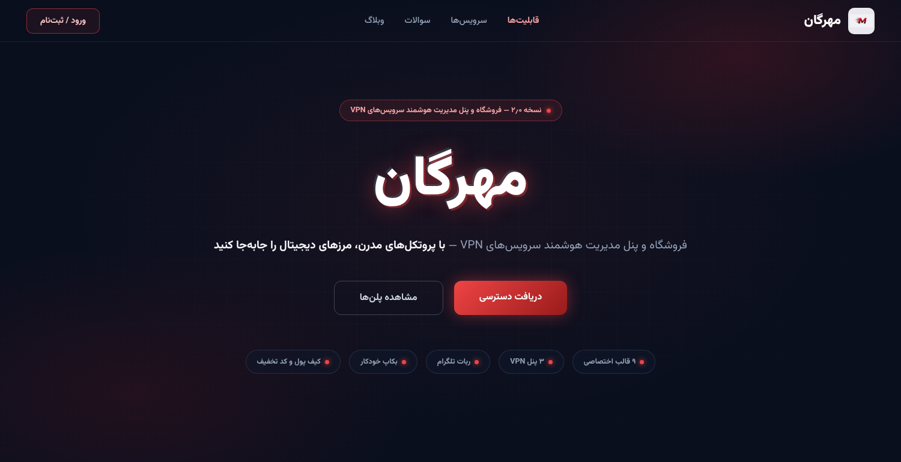
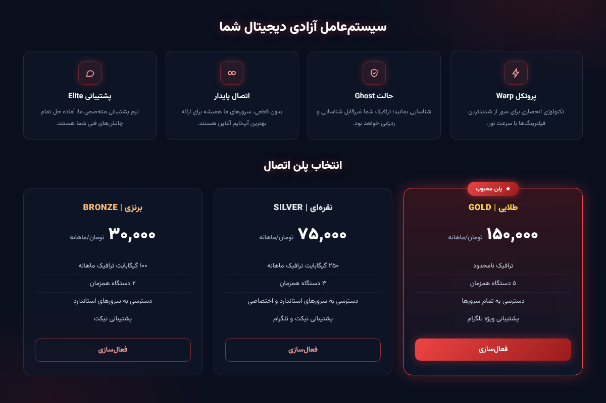

<p align="center">
  
</p>

<h1 align="center">مهرگان (Mehrgan)</h1>

<p align="center">
  فروشگاه و پنل مدیریت سرویس‌های VPN با پشتیبانی از Marzban، Sanaei/X-UI و PasarGuard
</p>

<p align="center">
  <a href="https://github.com/ehssanehs/Mehrgan"></a>
  <a href="https://www.php.net/"></a>
  <a href="https://filamentphp.com/"></a>
  <a href="https://opensource.org/licenses/MIT"></a>
</p>

> رابط کاربری سایت، ربات تلگرام و پنل مدیریت به‌صورت پیش‌فرض فارسی و راست‌به‌چپ است.

<p align="center">
  
  
  <br>
  
</p>

## فهرست مطالب

- [مهرگان چیست؟](#مهرگان-چیست)
- [امکانات](#امکانات)
- [پشته فنی و ساختار پروژه](#پشته-فنی-و-ساختار-پروژه)
- [پیش‌نیازها](#پیشنیازها)
- [نصب خودکار (Ubuntu)](#نصب-خودکار-ubuntu)
- [نصب دستی](#نصب-دستی)
- [راه‌اندازی اولیه](#راهاندازی-اولیه)
- [نقشه پنل مدیریت](#نقشه-پنل-مدیریت)
- [اتصال پنل VPN](#اتصال-پنل-vpn)
- [راه‌اندازی ربات تلگرام](#راهاندازی-ربات-تلگرام)
- [سفارش و پرداخت](#سفارش-و-پرداخت)
- [قالب‌های سایت](#قالبهای-سایت)
- [وارد کردن اشتراک قبلی](#وارد-کردن-اشتراک-قبلی)
- [نگهداری و آپدیت](#نگهداری-و-آپدیت)
- [بکاپ و بازیابی](#بکاپ-و-بازیابی)
- [تست و توسعه](#تست-و-توسعه)
- [مسیرها و APIها](#مسیرها-و-apiها)
- [متغیرهای محیطی](#متغیرهای-محیطی)
- [امنیت](#امنیت)
- [محدودیت‌های شناخته‌شده](#محدودیتهای-شناختهشده)
- [عیب‌یابی](#عیبیابی)
- [پشتیبانی](#پشتیبانی)

## مهرگان چیست؟

مهرگان یک نرم‌افزار کامل برای فروش و مدیریت سرویس VPN است که سایت فروش، پنل مدیریت و ربات تلگرام را روی یک دیتابیس مشترک جمع می‌کند:

- **سایت فروش** با نمایش پلن‌ها، سفارش، پرداخت، داشبورد کاربر و وبلاگ.
- **پنل مدیریت** روی `/admin` با Filament 3 (فارسی، RTL).
- **ربات تلگرام** برای ثبت‌نام، خرید، تحویل لینک، تمدید، تیکت و کارهای ادمین.
- **اتصال مستقیم** به پنل‌های Marzban، Sanaei/X-UI و PasarGuard برای ساخت و مدیریت کاربر.
- **مدیریت چند سرور** با لوکیشن، ظرفیت و انتخاب خودکار سرور.

این مخزن فقط سمت سرور است؛ اپلیکیشن native اندروید/iOS/ویندوز ندارد و به کاربر لینک اتصال و آموزش استفاده از کلاینت‌های V2RayNG، V2Box/Streisand و V2RayN ارائه می‌کند.

## امکانات

### سایت و حساب کاربری

- صفحه اصلی با پلن‌های فعال، قیمت، حجم، مدت و امکانات؛ مرتب‌شده بر اساس مدت (۳۰/۶۰/۹۰/۳۶۵ روز).
- ثبت‌نام، ورود، خروج، فراموشی رمز، تغییر رمز و تأیید ایمیل (Laravel Breeze).
- داشبورد کاربر:
  - سرویس‌های فعال و منقضی‌شده، شامل سرویس‌های وارد‌شده (Import).
  - لینک اتصال، تاریخ انقضا، تمدید و QR Code.
  - کیف پول، تاریخچه تراکنش‌ها و سفارش‌ها.
  - اعلان‌ها با امکان خوانده‌شدن.
  - تیکت‌های پشتیبانی.
- ویرایش پروفایل و حذف حساب.
- مسدودسازی کاربر توسط مدیر؛ کاربر Ban‌شده از سایت خارج و در ربات نیز مسدود می‌شود.
- وبلاگ در `/blog` با دسته‌بندی، اسلاگ، تصویر شاخص، ویرایشگر متن، پست‌های مرتبط، زمان‌بندی انتشار، فیلدهای SEO و شمارش بازدید.

### پنل مدیریت

- Filament 3 با شش ناحیه در سایدبار (جزئیات در [نقشه پنل مدیریت](#نقشه-پنل-مدیریت)).
- داشبورد با آمار درآمد کل و ماه جاری، تعداد کاربران، سفارش‌های موفق، تیکت‌های باز و تیکت‌های امروز.
- مدیریت سفارش‌ها با تأیید/رد دستی رسید و ساخت سرویس.
- مدیریت کاربران، مسدودسازی و افزایش/کاهش دستی موجودی کیف پول با ثبت توضیح.
- مدیریت پلن‌ها، کدهای تخفیف و گزارش سود در بازه زمانی.
- مدیریت لوکیشن‌ها، سرورها و ظرفیت.
- مدیریت محتوا: وبلاگ، FAQ و پیام همگانی تلگرام.
- مدیریت تنظیمات: سایت، ربات، اکانت تست، دعوت، نام‌گذاری ترتیبی، ماژول‌ها و بکاپ.

### ربات تلگرام

ربات بر پایه Webhook کار می‌کند و شامل این قابلیت‌هاست:

- ثبت‌نام خودکار با `/start` و اتصال حساب سایت به Chat ID.
- لینک دعوت با پارامتر referral (مثل `/start REF-ABC123`).
- نمایش پلن‌ها، انتخاب لوکیشن و سرور، انتخاب نام کاربری یا نام ترتیبی.
- کیف پول: مشاهده موجودی، شارژ با رسید و خرید با موجودی.
- پرداخت کارت‌به‌کارت و ارسال تصویر رسید برای تأیید ادمین.
- سرویس‌های من: لینک اتصال، تمدید، QR Code و بازگشت به لیست.
- تقسیم خودکار لینک‌های طولانی در چند پیام.
- وارد کردن اشتراک قبلی با `vless://` یا لینک Subscription.
- اکانت تست با حجم، مدت و محدودیت قابل تنظیم.
- سیستم دعوت و نمایش پاداش‌ها.
- FAQ و آموزش اتصال برای اندروید، iOS و ویندوز.
- تیکت پشتیبانی با ارسال متن یا تصویر.
- اجبار عضویت در کانال (Force Join).
- ثبت درخواست نمایندگی.
- تأیید/رد پرداخت و پاسخ به تیکت توسط ادمین از داخل تلگرام.
- ارسال پیام همگانی از پنل با صف (Queue).

متن خوش‌آمدگویی، آموزش‌ها، FAQ، مبالغ شارژ، Chat ID ادمین‌ها و نمایش دکمه‌ها از پنل مدیریت قابل تغییر است.

### پرداخت، کیف پول و تخفیف

- **کارت‌به‌کارت** با چند کارت بانکی؛ کارت به‌صورت تصادفی به کاربر نمایش داده می‌شود.
- توضیحات پرداخت (`payment_card_instructions`) در سایت و ربات به کاربر نشان داده می‌شود.
- ارسال تصویر رسید (حداکثر ۲ مگابایت) و بررسی آن توسط ادمین.
- **کیف پول**: شارژ با رسید، خرید آنی و افزایش/کاهش دستی توسط ادمین.
- **کد تخفیف**: درصدی یا مبلغ ثابت، سقف تخفیف، حداقل مبلغ سفارش، محدودیت تعداد استفاده کلی و هر کاربر، بازه زمانی و محدود کردن به پلن/شارژ کیف پول/تمدید.
- **NOWPayments**: وبهوک در `/webhooks/nowpayments` با بررسی امضای HMAC-SHA512 (جزئیات در [سفارش و پرداخت](#سفارش-و-پرداخت)).
- پرداخت با ارز دیجیتال از سایت فعلاً Placeholder است و کاربر به کارت‌به‌کارت هدایت می‌شود.

### پنل‌های VPN پشتیبانی‌شده

| پنل | قابلیت‌ها | نوع لینک |
|---|---|---|
| **Sanaei / X-UI** | ورود، دریافت اینباند، ساخت و ویرایش کاربر، ریست مصرف، غیرفعال‌سازی، جستجوی UUID | لینک تکی VLESS، لینک Subscription یا لینک Tunnel |
| **Marzban** | ورود با توکن، ساخت و ویرایش کاربر، دریافت اطلاعات، ریست مصرف، غیرفعال‌سازی، جستجوی UUID | لینک Subscription و Node Hostname اختیاری |
| **PasarGuard** | ورود با توکن، ساخت و ویرایش کاربر، دریافت اطلاعات، ریست مصرف، غیرفعال‌سازی، جستجوی UUID | لینک Subscription و Node Hostname اختیاری |

دو حالت پشتیبانی می‌شود:

1. **MultiServer (پیشنهادی)** — لوکیشن + سرور + ظرفیت، انتخاب خودکار سرور دارای ظرفیت.
2. **تک‌سرور قدیمی** — کلیدهای `xui_*`، `marzban_*` و `pasarguard_*` در جدول `settings`.

> فیلتر نوع سرور در فرم پلن شامل `all`، `xui` و `marzban` است. برای پلن اختصاصی PasarGuard باید مقدار enum و فرم را توسعه دهید.

### اکانت تست

- فعال/غیرفعال کردن اکانت تست.
- انتخاب سرور مخصوص تست.
- حجم (مگابایت)، مدت (ساعت) و تعداد مجاز برای هر کاربر.
- نمایش یا مخفی کردن دکمه «اکانت تست» در منوی ربات.
- ساخت لینک، کپی و QR Code از داخل ربات.

### سیستم دعوت

- کد دعوت یکتا برای هر کاربر (`REF-XXXXXX`).
- لینک دعوت در سایت و ربات.
- پاداش ثابت یا درصدی برای معرف.
- هدیه خوش‌آمدگویی برای کاربر جدید.
- پاداش فقط برای اولین خرید موفق و با حداقل مبلغ قابل تنظیم.
- بررسی IP برای جلوگیری از سوءاستفاده از هدیه.
- پیام تلگرام برای معرف و کاربر جدید.
- گزارش تعداد ثبت‌نام، خرید موفق، درآمد و موجودی کیف پول.

### نام‌گذاری ترتیبی کلاینت‌ها

- فعال/غیرفعال کردن سیستم.
- تعیین پیشوند (مثل `server1u`).
- شمارنده فعلی و نام بعدی.
- ریست شمارنده؛ تغییر پیشوند شمارنده را از ۱ شروع می‌کند.
- جلوگیری از تکرار شماره با قفل دیتابیس.
- نام سفارشی کاربر همیشه اولویت دارد.
- در حالت خاموش، الگوی `user-{id}-order-{id}` استفاده می‌شود.

### تیکت، اعلان و پیام همگانی

- تیکت با اولویت کم/متوسط/زیاد و وضعیت باز/پاسخ‌داده‌شده/بسته.
- پاسخ از سایت یا تلگرام.
- پیوست JPG، PNG، PDF و ZIP تا ۵ مگابایت.
- اعلان پاسخ تیکت در تلگرام.
- ارسال پیام همگانی تلگرام با صف (Queue) به همه کاربرانی که Chat ID دارند.

### نمایندگی

- دو نوع پلن: **سهمیه‌ای** (`quota`) و **پرداخت به‌ازای هر اکانت** (`pay_as_you_go`).
- ثبت درخواست نمایندگی و تأیید/رد توسط ادمین.
- کیف پول نماینده و تاریخچه تراکنش‌ها.
- تعریف سرور و محصول VPN برای نماینده.
- پشتیبانی از هر سه پنل در سرویس نمایندگی.
- ساخت اکانت در صف با تلاش مجدد و برگشت خودکار مبلغ در صورت شکست دائمی.
- ذخیره وضعیت، تاریخ انقضا، لینک اشتراک و پاسخ خام پنل.
- QR Code برای اکانت نماینده.
- API نمایندگی در `/api/v1/reseller` (Sanctum).

> مدل‌های قدیمی `Agent`، `AgentServer` و `AgentTransaction` برای سازگاری در پروژه مانده‌اند اما در منوی پنل نمایش داده نمی‌شوند؛ پیاده‌سازی پشتیبانی‌شده ماژول `Reseller` است.

### بکاپ و مدیریت ماژول‌ها

- ساخت ZIP شامل Dump دیتابیس، اطلاعات نسخه و `storage/app/public`.
- ساخت، آپلود، دانلود، بازیابی (Restore) و حذف بکاپ از پنل.
- ارسال بکاپ به یک یا چند Chat ID ادمین.
- اجرای روزانه `backup:daily-telegram` با Scheduler.
- نصب ماژول ZIP از پنل، فعال/غیرفعال‌سازی و حذف ماژول (`nwidart/laravel-modules`).

## پشته فنی و ساختار پروژه

| لایه | فناوری |
|---|---|
| Backend | PHP 8.3+، Laravel 12 |
| پنل مدیریت | Filament 3 + Livewire |
| دیتابیس | MySQL 8 / MariaDB |
| صف و کش | Redis (پیشنهادی) |
| Frontend | Blade + Tailwind CSS + Alpine.js + Vite |
| ربات | `irazasyed/telegram-bot-sdk` |
| ماژول‌ها | `nwidart/laravel-modules` |

```text
app/
  Filament/                  منابع و صفحات پنل مدیریت
  Http/Controllers/          OrderController، SubscriptionImport، Webhook
  Models/                    User، Plan، Order، Setting، Transaction …
  Services/                  Marzban، XUI، PasarGuard، Import، Naming، Notification
  Support/SiteTheme.php      پالت قالب‌ها و رنگ‌های پنل
Modules/
  Blog/                      وبلاگ
  MatinBackup/               بکاپ و ارسال به تلگرام
  MultiServer/               لوکیشن، سرور، ظرفیت، اتصال پنل‌ها
  Referral/                  گزارش و منطق دعوت
  Reseller/                  نمایندگی، کیف پول، محصول و API
  TelegramBot/               وبهوک و کل منطق ربات
  Ticketing/                 تیکت پشتیبانی
resources/views/
  themes/arcane.blade.php    قالب تیره
  themes/aurora.blade.php    قالب روشن
  layouts/                   لایه‌های سایت، پنل و احراز هویت
public/themes/               CSS و asset هر قالب
routes/web.php               مسیرهای سایت، پرداخت و وبهوک‌ها
install.sh / update.sh       نصب چندنمونه‌ای و آپدیت
manage.sh / uninstall.sh     مدیریت و حذف نمونه‌ها
```

همه ماژول‌های `modules_statuses.json` به‌صورت پیش‌فرض فعال‌اند و Resourceهایشان خودکار در Filament شناسایی می‌شوند.

## پیش‌نیازها

### نرم‌افزار

- Ubuntu 22.04/24.04 برای اسکریپت نصب خودکار.
- PHP **8.3 یا بالاتر** با افزونه‌های:
  `bcmath`، `curl`، `dom`، `gd`، `intl`، `mbstring`، `pdo_mysql`، `redis`، `xml`، `zip`.
- Composer 2.
- Node.js LTS و npm (فقط برای Build).
- MySQL 8 یا MariaDB.
- Redis.
- Nginx.
- Supervisor برای Queue Worker.
- Cron یا systemd timer برای Scheduler.
- دامنه با رکورد A/AAAA و گواهی SSL (وبهوک تلگرام HTTPS می‌خواهد).

### سرویس‌های خارجی

- یک پنل Marzban، Sanaei/X-UI یا PasarGuard در دسترس.
- توکن ربات تلگرام (در صورت فعال بودن ربات).
- SMTP واقعی برای ایمیل تأیید و بازیابی رمز.
- دامنه Subscription/Tunnel در صورت استفاده از حالت‌های خاص X-UI.

## نصب خودکار (Ubuntu)

اسکریپت `install.sh` چند نمونه مستقل نصب می‌کند؛ هر نمونه پوشه، دیتابیس، سایت Nginx، Worker و Cron جداگانه دارد.

```bash
cd /tmp
git clone https://github.com/ehssanehs/Mehrgan.git
cd Mehrgan
sudo bash install.sh
```

اسکریپت این موارد را می‌پرسد:

1. نام پوشه نمونه (مثل `mehrgan-1`).
2. دامنه (مثل `vpn.example.com`).
3. نام دیتابیس، نام کاربری و رمز دیتابیس.
4. ایمیل و رمز اولیه مدیر.
5. ایمیل دریافت گواهی SSL.
6. فعال بودن SSL.

اگر تأیید کنید پیش‌نیازها نصب نیستند، اسکریپت Nginx، MySQL، Redis، Supervisor، Certbot، PHP 8.3 با افزونه‌ها، Node.js و Composer را نصب می‌کند. سپس کد را دریافت، `.env` را تنظیم، مایگریشن و Seed را اجرا، `storage:link` و Build را انجام و تنظیمات Nginx/Supervisor/Cron را ایجاد می‌کند.

> **هشدار:** بخش نصب پیش‌نیازها برای سرور Ubuntu تمیز نوشته شده و ممکن است نسخه‌های قبلی PHP را تغییر دهد. روی سروری که سرویس دیگری دارد، قبل از اجرا بکاپ بگیرید یا این مرحله را دستی انجام دهید.

پس از پایان:

```bash
sudo supervisorctl status
sudo systemctl status nginx php8.3-fpm mysql redis-server supervisor
```

سایت روی `/` و پنل روی `/admin` بالا می‌آید.

## نصب دستی

در دستورات زیر `/var/www/mehrgan` و `vpn.example.com` را جایگزین کنید.

### ۱. پکیج‌ها

```bash
sudo apt update
sudo apt install -y git curl unzip zip build-essential nginx mysql-server redis-server supervisor \
  certbot python3-certbot-nginx software-properties-common

sudo add-apt-repository -y ppa:ondrej/php
sudo apt update
sudo apt install -y php8.3 php8.3-cli php8.3-fpm php8.3-mysql php8.3-mbstring \
  php8.3-xml php8.3-curl php8.3-zip php8.3-bcmath php8.3-intl php8.3-gd \
  php8.3-dom php8.3-redis

curl -fsSL https://deb.nodesource.com/setup_lts.x | sudo -E bash -
sudo apt install -y nodejs

php -r "copy('https://getcomposer.org/installer', 'composer-setup.php');"
sudo php composer-setup.php --install-dir=/usr/local/bin --filename=composer
rm composer-setup.php

sudo systemctl enable --now nginx php8.3-fpm mysql redis-server supervisor
```

### ۲. دیتابیس

```sql
CREATE DATABASE mehrgan CHARACTER SET utf8mb4 COLLATE utf8mb4_unicode_ci;
CREATE USER 'mehrgan_app'@'localhost' IDENTIFIED BY 'یک-رمز-قوی';
GRANT ALL PRIVILEGES ON mehrgan.* TO 'mehrgan_app'@'localhost';
FLUSH PRIVILEGES;
```

### ۳. دریافت کد

```bash
sudo mkdir -p /var/www
sudo git clone https://github.com/ehssanehs/Mehrgan.git /var/www/mehrgan
sudo chown -R www-data:www-data /var/www/mehrgan
cd /var/www/mehrgan
```

### ۴. فایل `.env`

```bash
sudo -u www-data cp .env.example .env
sudo -u www-data nano .env
```

حداقل مقادیر لازم:

```dotenv
APP_NAME=Mehrgan
APP_ENV=production
APP_DEBUG=false
APP_URL=https://vpn.example.com

ADMIN_EMAIL=admin@example.com
ADMIN_PASSWORD=رمز-قوی-مدیر

DB_CONNECTION=mysql
DB_HOST=127.0.0.1
DB_PORT=3306
DB_DATABASE=mehrgan
DB_USERNAME=mehrgan_app
DB_PASSWORD=رمز-دیتابیس

SESSION_DRIVER=database
CACHE_STORE=database
QUEUE_CONNECTION=redis
FILESYSTEM_DISK=local

REDIS_CLIENT=phpredis
REDIS_HOST=127.0.0.1
REDIS_PORT=6379
REDIS_PASSWORD=null
```

`ADMIN_EMAIL` و `ADMIN_PASSWORD` فقط در Seed اولیه استفاده می‌شوند و اجرای دوباره Seed رمز مدیر موجود را تغییر نمی‌دهد.

### ۵. نصب وابستگی‌ها

```bash
cd /var/www/mehrgan
sudo -u www-data composer install --no-dev --optimize-autoloader --no-interaction
sudo -u www-data HOME=/var/www npm ci
sudo -u www-data php artisan key:generate --force
```

### ۶. مایگریشن، Storage و Build

```bash
sudo -u www-data php artisan migrate --seed --force
sudo -u www-data php artisan storage:link
sudo -u www-data HOME=/var/www npm run build

sudo chown -R www-data:www-data storage bootstrap/cache
sudo chmod -R ug+rwX storage bootstrap/cache
```

`public/build` در Git نیست؛ بعد از هر نصب یا تغییر Frontend باید `npm run build` اجرا شود.

### ۷. Nginx

```nginx
server {
    listen 80;
    listen [::]:80;
    server_name vpn.example.com;

    root /var/www/mehrgan/public;
    index index.php;
    client_max_body_size 10M;

    location / {
        try_files $uri $uri/ /index.php?$query_string;
    }

    location ~ \.php$ {
        include snippets/fastcgi-php.conf;
        fastcgi_pass unix:/run/php/php8.3-fpm.sock;
        fastcgi_param SCRIPT_FILENAME $realpath_root$fastcgi_script_name;
    }

    location ~ /\.(?!well-known).* {
        deny all;
    }
}
```

```bash
sudo ln -s /etc/nginx/sites-available/mehrgan /etc/nginx/sites-enabled/mehrgan
sudo nginx -t && sudo systemctl reload nginx
```

### ۸. Queue Worker

`/etc/supervisor/conf.d/mehrgan-worker.conf`:

```ini
[program:mehrgan-worker]
process_name=%(program_name)s_%(process_num)02d
command=php /var/www/mehrgan/artisan queue:work redis --sleep=3 --tries=3 --max-time=3600
directory=/var/www/mehrgan
autostart=true
autorestart=true
stopasgroup=true
killasgroup=true
user=www-data
numprocs=2
redirect_stderr=true
stdout_logfile=/var/log/supervisor/mehrgan-worker.log
stopwaitsecs=3600
```

```bash
sudo supervisorctl reread && sudo supervisorctl update
sudo supervisorctl start "mehrgan-worker:*"
```

Worker برای پیام همگانی تلگرام و ساخت اکانت نمایندگی لازم است.

### ۹. Scheduler

`/etc/cron.d/mehrgan`:

```cron
* * * * * www-data cd /var/www/mehrgan && php artisan schedule:run >> /dev/null 2>&1
```

### ۱۰. SSL

```bash
sudo certbot --nginx -d vpn.example.com -m admin@example.com --agree-tos --redirect
sudo -u www-data php artisan optimize:clear
sudo -u www-data php artisan config:cache
sudo -u www-data php artisan view:cache
```

### ۱۱. بررسی نهایی

```bash
curl -I https://vpn.example.com
sudo supervisorctl status
sudo -u www-data php artisan about
```

## راه‌اندازی اولیه

پس از نصب، به `/admin` بروید و با ایمیل/رمز مدیر وارد شوید. اگر رمز پیش‌فرض است، فوراً تغییرش دهید. سپس به همین ترتیب پیش بروید:

1. **تنظیمات → تنظیمات سایت** — انتخاب قالب، متن‌های صفحه اصلی، کارت‌های بانکی و توضیحات پرداخت، لینک ورود سایت برای ربات، تنظیمات ربات و متن‌های صفحات ورود/ثبت‌نام.
2. **سرورها → لوکیشن‌ها** — ساخت کشور/لوکیشن.
3. **سرورها → سرورها** — ساخت سرور با نوع پنل، اطلاعات ورود، اینباند و ظرفیت.
4. **سرورها → تنظیمات مولتی سرور** — بررسی وضعیت و پیش‌فرض‌ها.
5. **فروش → پلن‌های سرویس** — حداقل یک پلن فعال (نام، قیمت، حجم، مدت، امکانات، نوع سرور).
6. **تنظیمات → محتوای ربات تلگرام** — توکن، Chat ID ادمین، متن خوش‌آمدگویی، آموزش‌ها و مبالغ شارژ.
7. **تنظیمات → تنظیمات اکانت تست** و **تنظیمات دعوت** — در صورت نیاز.
8. **تنظیمات → مدیریت بکاپ‌ها** — بررسی دسترسی `mysqldump` و Chat ID دریافت بکاپ.

### تست کامل قبل از فروش

1. ثبت‌نام و ورود سایت.
2. `/start` در ربات و نمایش پلن‌ها.
3. خرید یک پلن کم‌حجم روی هر سه نوع پنل.
4. پرداخت کارت‌به‌کارت، ارسال رسید و تأیید ادمین.
5. شارژ کیف پول و خرید با موجودی.
6. دریافت لینک، کپی لینک و QR Code در تلگرام.
7. تمدید و ریست مصرف.
8. کد تخفیف و پاداش دعوت.
9. ساخت و پاسخ تیکت.
10. Queue، Scheduler و بکاپ.

## نقشه پنل مدیریت

سایدبار شش ناحیه دارد و هر تنظیم دقیقاً یک جای مشخص:

| ناحیه | صفحات |
|---|---|
| **فروش** | سفارشات، پلن‌های سرویس، کدهای تخفیف، گزارش سود |
| **کاربران** | کاربران سایت، تیکت‌های پشتیبانی، گزارش دعوت‌ها |
| **نمایندگی** | نمایندگان، درخواست‌های نمایندگی، پلن‌های نمایندگی، محصولات VPN، سرورهای VPN، تنظیمات نمایندگی |
| **سرورها** | لوکیشن‌ها، سرورها، تنظیمات مولتی سرور |
| **محتوا** | پست‌ها، دسته‌بندی‌ها، سوالات متداول، پیام همگانی تلگرام |
| **تنظیمات** | تنظیمات سایت، محتوای ربات تلگرام، تنظیمات اکانت تست، تنظیمات نام‌گذاری ترتیبی، تنظیمات دعوت، مدیریت افزونه‌ها، مدیریت بکاپ‌ها |

نکته‌های مهم:

- تنظیمات سایت شامل تب‌های «تنظیمات قالب»، «محتوای قالب» (فقط قالب فعال نمایش داده می‌شود)، «محتوای صفحات ورود»، «تنظیمات پنل V2Ray»، «تنظیمات پرداخت» و «تنظیمات ربات تلگرام» است.
- دکمه نمایش اکانت تست در صفحه «تنظیمات اکانت تست» و دکمه نمایندگی در «تنظیمات نمایندگی» قرار دارد.
- کارت‌های شارژ نماینده فقط در «تنظیمات نمایندگی» قابل ویرایش است.

## اتصال پنل VPN

### روش پیشنهادی (MultiServer)

1. یک لوکیشن بسازید.
2. یک سرور فعال در آن لوکیشن بسازید.
3. نوع پنل را انتخاب کنید.
4. اطلاعات ورود را وارد کنید.
5. در X-UI، اینباند فعال و صحیح را انتخاب کنید.
6. نوع لینک خروجی را تعیین کنید (`single`، `subscription` یا `tunnel`).
7. یک پلن سازگار بسازید.
8. یک خرید آزمایشی انجام دهید و کاربر را در پنل VPN بررسی کنید.

### حالت تک‌سرور قدیمی

کلیدهای `xui_*`، `marzban_*` و `pasarguard_*` در جدول `settings` پشتیبانی می‌شوند، اما برای نصب جدید MultiServer توصیه می‌شود.

> منطق ساخت سرویس در چند مسیر تکرار شده است (`OrderController`، `OrderResource`، وبهوک تلگرام و Trait مربوط به Provisioning). هر تغییر در ساخت سرویس باید در همه این مسیرها اعمال شود.

### بررسی ارتباط

از سرور مهرگان مطمئن شوید:

- دامنه پنل Resolve می‌شود و پورت باز است.
- کاربر API می‌تواند Login کند.
- اینباند فعال است.
- دامنه Subscription/Tunnel به مقصد درست اشاره می‌کند.
- واحد حجم و زمان با API پنل هماهنگ است.

## راه‌اندازی ربات تلگرام

### ۱. ساخت ربات

در BotFather یک ربات بسازید و توکن را محرمانه نگه دارید.

### ۲. ذخیره توکن و Chat ID

در **تنظیمات → تنظیمات سایت** (تب «تنظیمات ربات تلگرام») یا **تنظیمات → محتوای ربات تلگرام**:

- `telegram_bot_token`
- `telegram_admin_chat_id` (عددی، می‌تواند چند مقدار باشد)
- `site_login_url`
- تنظیمات اجبار عضویت در کانال
- متن خوش‌آمدگویی، آموزش‌ها و مبالغ شارژ

توکن اصلی از دیتابیس خوانده می‌شود؛ `TELEGRAM_BOT_TOKEN` در `.env` فقط Fallback پکیج است.

اگر سرور برای تلگرام Proxy لازم دارد، `TELEGRAM_PROXY` را در `.env` تنظیم کنید. اگر اجبار عضویت فعال است، ربات باید در کانال Administrator باشد.

### ۳. ثبت وبهوک

`APP_URL` باید دامنه عمومی HTTPS باشد، سپس:

```bash
sudo -u www-data php artisan telegram:set-webhook
```

این دستور:

- آدرس `https://your-domain.example/webhooks/telegram` را ثبت می‌کند؛
- یک `telegram_webhook_secret` می‌سازد، در تنظیمات ذخیره می‌کند و به تلگرام می‌فرستد؛
- توکن ربات را در بدنه درخواست می‌فرستد تا در Access Log ثبت نشود.

> **مهم:** وبهوک تلگرام فقط درخواست‌هایی را می‌پذیرد که هدر `X-Telegram-Bot-Api-Secret-Token` آن‌ها با مقدار ذخیره‌شده بخواند. اگر secret ثبت نشده باشد، آپدیت‌ها با 403 رد می‌شوند و پیام راهنما در Log ثبت می‌شود. بعد از هر بار عوض کردن دامنه، اجرای دوباره این دستور لازم است.

### ۴. تست

در ربات `/start` بفرستید و این موارد را بررسی کنید: نمایش پلن‌ها، وارد کردن اشتراک، اکانت تست، ارسال رسید، ساخت تیکت و دریافت لینک.

خطاها در `storage/logs/laravel.log` ثبت می‌شوند.

## سفارش و پرداخت

### خرید از سایت

1. کاربر پلن را انتخاب می‌کند.
2. سفارش در وضعیت Pending ساخته می‌شود.
3. در حالت چندسروری، سرور انتخاب می‌شود (یا خودکار انتخاب می‌شود).
4. کد تخفیف در صورت وجود اعمال می‌شود.
5. پرداخت با کیف پول یا کارت انجام می‌شود.
6. پرداخت کیف پول آنی پردازش می‌شود.
7. پرداخت کارت‌به‌کارت تا تأیید ادمین در انتظار می‌ماند.
8. پس از تأیید، کاربر در پنل VPN ساخته و لینک ذخیره می‌شود.
9. کاربر از سایت و تلگرام اعلان می‌گیرد.

### NOWPayments

مسیر: `POST /webhooks/nowpayments`

- امضای `x-nowpayments-sig` با HMAC-SHA512 روی بدنه‌ای که کلیدهایش به‌صورت بازگشتی مرتب شده‌اند بررسی می‌شود.
- اگر `NOWPAYMENTS_IPN_SECRET` خالی باشد، endpoint با **503** پاسخ می‌دهد (Fail-Closed).
- فقط وضعیت‌های `finished` و `confirmed` پرداخت‌شده محسوب می‌شوند؛ `sending` نادیده گرفته می‌شود.
- بعد از پرداخت تأییدشده، رویداد `OrderPaid` dispatch می‌شود تا پاداش دعوت و اعلان‌ها مثل بقیه مسیرها اجرا شوند.
- تکرار callback همان سفارش، دوباره پردازش نمی‌شود.

برای فعال‌سازی، مقدار IPN Secret را از داشبورد NOWPayments در `.env` قرار دهید:

```dotenv
NOWPAYMENTS_IPN_SECRET=...
```

> ساخت خودکار سرویس بعد از پرداخت NOWPayments انجام نمی‌شود؛ سفارش «پرداخت‌شده» می‌شود و ساخت سرویس مثل پرداخت کارت‌به‌کارت توسط ادمین انجام می‌شود.

### محدودیت حجم فایل

- رسید کارت در سایت: حداکثر ۲ مگابایت.
- پیوست تیکت: JPG/JPEG/PNG/PDF/ZIP حداکثر ۵ مگابایت.
- در Nginx مقدار `client_max_body_size` حداقل ۱۰ مگابایت باشد.
- `php artisan storage:link` باید اجرا شده باشد.

## قالب‌های سایت

دو قالب نگهداری می‌شود:

| کلید | حالت | کاربرد |
|---|---|---|
| `arcane` | تیره | قالب پیش‌فرض |
| `aurora` | روشن | مناسب برندهای روشن |

- انتخاب قالب: **تنظیمات → تنظیمات سایت → تنظیمات قالب**.
- `SiteTheme::available()` تنها منبع معتبر فهرست قالب‌هاست؛ اگر مقدار ذخیره‌شده معتبر نباشد، سایت به قالب پیش‌فرض برمی‌گردد.
- متن‌های هر قالب (برند، Hero، ویژگی‌ها، عنوان پلن‌ها، FAQ و فوتر) از تب «محتوای قالب» همان قالب قابل ویرایش است.
- متن‌های صفحات ورود و ثبت‌نام از تب «محتوای صفحات ورود» کنترل می‌شوند.
- رنگ پنل مدیریت نیز از پالت قالب فعال گرفته می‌شود.

افزودن قالب جدید: پالت را در `app/Support/SiteTheme.php` اضافه کنید، ویو `resources/views/themes/{key}.blade.php` و پوشه `public/themes/{key}` را بسازید و گزینه و تب محتوای آن را در `ThemeSettings` اضافه کنید.

## وارد کردن اشتراک قبلی

از سایت در `/subscription/import` یا از ربات تلگرام.

ورودی‌های مجاز:

1. یک لینک `vless://...`
2. یک لینک `http://` یا `https://` که محتوای آن شامل لینک VLESS باشد.

مراحل:

1. تشخیص و اعتبارسنجی ورودی.
2. دریافت محتوای Subscription URL.
3. Decode کردن Base64 در صورت نیاز.
4. استفاده از UUID اولین لینک VLESS معتبر.
5. جلوگیری از وارد کردن UUID تکراری.
6. جستجو در سرورهای فعال MultiServer و تنظیمات تک‌سرور.
7. خواندن نام کاربری، حجم، مصرف، تاریخ انقضا و لینک اشتراک از پنل.
8. ساخت یک سفارش پرداخت‌شده برای کاربر.

محدودیت‌ها: حداکثر ۱۰٬۰۰۰ کاراکتر، فقط HTTP/HTTPS، و مسدودسازی localhost و IPهای خصوصی برای کاهش خطر SSRF. مسیر JSON: `POST /subscription/import/api` (نیازمند ورود).

داشبورد سرویس‌های Import‌شده را حداکثر یک‌بار در ۲۴ ساعت با پنل همگام می‌کند تا تاریخ انقضا اصلاح شود.

## نگهداری و آپدیت

### آپدیت دستی

```bash
cd /var/www/mehrgan
sudo cp .env ".env.backup.$(date +%Y%m%d-%H%M%S)"
sudo -u www-data php artisan down --retry=60

sudo -u www-data git fetch origin --prune
sudo -u www-data git pull --ff-only origin main
sudo -u www-data composer install --no-dev --optimize-autoloader --no-interaction
sudo -u www-data HOME=/var/www npm ci
sudo -u www-data HOME=/var/www npm run build
sudo -u www-data php artisan migrate --force
sudo -u www-data php artisan storage:link || true
sudo -u www-data php artisan optimize:clear
sudo -u www-data php artisan config:cache
sudo -u www-data php artisan view:cache
sudo -u www-data php artisan event:cache
sudo supervisorctl restart "mehrgan-worker:*"
sudo -u www-data php artisan up
```

اگر آپدیت در حالت Maintenance متوقف شد:

```bash
cd /var/www/mehrgan
sudo -u www-data php artisan optimize:clear
sudo -u www-data php artisan up
sudo supervisorctl status
```

### اسکریپت `update.sh`

```bash
cd /var/www/mehrgan-1
sudo bash update.sh
# یا
sudo bash update.sh --path=/var/www/mehrgan-1
```

اسکریپت از `.env` بکاپ می‌گیرد، سایت را Maintenance می‌کند، کد را به‌روز می‌کند، Composer و npm را اجرا می‌کند، مایگریشن می‌زند، Worker را ری‌استارت می‌کند و کش‌ها را می‌سازد.

> این اسکریپت ممکن است تغییرات محلی Git را Stash یا Reset کند. همچنین در نسخه فعلی `route:cache` را اجرا می‌کند، در حالی که پروژه Route Closure دارد و این مرحله می‌تواند خطا بدهد. در صورت خطا `php artisan up` را اجرا کنید و Route Cache را انجام ندهید.

### مدیریت نمونه‌ها

```bash
bash manage.sh list
bash manage.sh status
bash manage.sh status mehrgan-1
bash manage.sh restart mehrgan-1
bash manage.sh stop mehrgan-1
bash manage.sh start mehrgan-1
```

### حذف نمونه

حذف برگشت‌پذیر نیست و Worker، Nginx، Cron، گواهی SSL، دیتابیس و پوشه پروژه را پاک می‌کند:

```bash
sudo bash uninstall.sh --slug=mehrgan-1
```

`--all` همه نمونه‌های شناسایی‌شده را حذف می‌کند. قبل از حذف بکاپ سالم بگیرید.

## بکاپ و بازیابی

از **تنظیمات → مدیریت بکاپ‌ها** می‌توانید بکاپ بسازید، آپلود، دانلود، بازیابی یا حذف کنید و آن را به تلگرام ادمین‌ها بفرستید.

اجرای دستی:

```bash
sudo -u www-data php artisan backup:daily-telegram
```

Scheduler همین دستور را روزانه اجرا می‌کند.

پیش‌نیازها: `mysqldump`، افزونه `ZipArchive`، اطلاعات صحیح دیتابیس و برای ارسال به تلگرام، توکن و Chat ID.

> Restore دیتابیس و `storage/app/public` فعلی را جایگزین می‌کند. ابتدا روی محیط آزمایشی تست کنید. فایل بکاپ حاوی اطلاعات حساس است و باید خصوصی نگه داشته شود.

## تست و توسعه

### نصب وابستگی‌های توسعه

```bash
composer install
npm ci
```

### اجرای تست‌ها

تست‌ها روی **MySQL** اجرا می‌شوند، نه SQLite؛ مایگریشن‌ها از `ALTER ... MODIFY ... ENUM` خام استفاده می‌کنند که در SQLite کار نمی‌کند.

یک دیتابیس جدا برای تست بسازید و فقط متغیرهای `DB_*` را پاس بدهید:

```bash
mysql -e "CREATE DATABASE IF NOT EXISTS mehrgan_test CHARACTER SET utf8mb4 COLLATE utf8mb4_unicode_ci;"

APP_ENV=testing \
DB_CONNECTION=mysql DB_HOST=127.0.0.1 DB_DATABASE=mehrgan_test \
DB_USERNAME=mehrgan_app DB_PASSWORD='رمز-دیتابیس' \
php artisan test
```

> **تله مهم:** هرگز قبل از تست `set -a; . ./.env` اجرا نکنید. این کار `APP_ENV=local` و `SESSION_DRIVER=database` را Export می‌کند، مقادیر `phpunit.xml` را می‌پوشاند و باعث خطاهای ۴۱۹ و شکست تست‌های ورود می‌شود.

اجرای بخشی از تست‌ها:

```bash
php artisan test --filter=VlessParser
php artisan test --filter=SubscriptionImport
php artisan test --filter=TelegramWebhookSecurity
php artisan test --filter=NowPayments
```

### توسعه

```bash
composer run dev
```

یا جداگانه:

```bash
php artisan serve
php artisan queue:listen --tries=1
npm run dev
```

### Build فرانت‌اند

```bash
npm run build
```

## مسیرها و APIها

فهرست کامل:

```bash
php artisan route:list
```

### مسیرهای اصلی سایت

| متد | مسیر | کاربرد |
|---|---|---|
| `GET` | `/` | صفحه اصلی و پلن‌ها |
| `GET` | `/blog` و `/blog/{slug}` | وبلاگ |
| `GET/POST` | `/login`، `/register`، `/forgot-password` | احراز هویت |
| `GET` | `/dashboard` | داشبورد کاربر |
| `GET` | `/profile` | پروفایل |
| `GET` | `/notifications` | اعلان‌ها |
| `GET` | `/tickets` | تیکت‌ها |
| `POST` | `/order/{plan}` | ثبت سفارش |
| `GET` | `/order/{order}` | جزئیات سفارش |
| `POST` | `/order/{order}/apply-discount` | اعمال کد تخفیف |
| `POST` | `/order/{order}/renew` | تمدید |
| `GET/POST` | `/payment/card/{order}` | پرداخت کارت‌به‌کارت |
| `POST` | `/payment/wallet/{order}` | پرداخت با کیف پول |
| `POST` | `/payment/crypto/{order}` | پرداخت کریپتو (Placeholder) |
| `GET/POST` | `/subscription/import` | وارد کردن اشتراک |
| `POST` | `/subscription/import/api` | نسخه JSON |

### وبهوک‌ها

| متد | مسیر | احراز هویت |
|---|---|---|
| `POST` | `/webhooks/telegram` | هدر `X-Telegram-Bot-Api-Secret-Token` |
| `POST` | `/webhooks/nowpayments` | امضای `x-nowpayments-sig` (HMAC-SHA512) |

### API ماژول‌ها

محافظت‌شده با Sanctum (`Authorization: Bearer <token>`):

- `/api/v1/reseller/profile`، `/servers`، `/accounts`، `/accounts/{id}`
- `/api/v1/tickets`
- `/api/v1/multiservers`
- `/api/v1/referrals`
- `/api/v1/telegrambots`
- `/api/v1/test/vpn/create` و `/api/v1/test/vpn/delete/{id}` (مسیرهای تست)

بدون احراز هویت (برای استفاده داخلی/ربات):

- `/api/v1/telegram/plans`
- `/api/v1/telegram/reseller/apply`
- `/api/v1/telegram/reseller/status/{user_id}`

> این سه مسیر عمومی هستند و وضعیت درخواست نمایندگی را بر اساس `user_id` برمی‌گردانند. اگر برای مصرف خارجی استفاده می‌شوند، حتماً به Sanctum یا Throttle محدود شوند.

## متغیرهای محیطی

| متغیر | کاربرد |
|---|---|
| `APP_ENV` | در Production مقدار `production`. |
| `APP_DEBUG` | در Production مقدار `false`. |
| `APP_URL` | دامنه عمومی HTTPS و مبنای وبهوک تلگرام. |
| `APP_KEY` | کلید رمزنگاری؛ با `key:generate`. |
| `ADMIN_EMAIL` / `ADMIN_PASSWORD` | اطلاعات مدیر در Seed اولیه. |
| `DB_*` | اتصال MySQL/MariaDB. |
| `SESSION_DRIVER` | معمولاً `database`. |
| `CACHE_STORE` | `database` یا `redis`. |
| `QUEUE_CONNECTION` | در نصب پیشنهادی `redis`. |
| `REDIS_*` | اتصال Redis. |
| `FILESYSTEM_DISK` | دیسک فایل‌ها؛ Storage Link لازم است. |
| `MAIL_*` | ارسال واقعی ایمیل (نمونه از Log استفاده می‌کند). |
| `TELEGRAM_PROXY` | Proxy اختیاری برای تلگرام. |
| `HTTP_PROXY` | Proxy اختیاری برای درخواست‌های X-UI. |
| `TELEGRAM_BOT_TOKEN` | فقط Fallback پکیج؛ توکن اصلی در پنل ذخیره می‌شود. |
| `NOWPAYMENTS_IPN_SECRET` | Secret بررسی امضای وبهوک NOWPayments. |
| `VITE_APP_NAME` | نام برنامه در Build فرانت‌اند. |

تنظیمات کسب‌وکار (پنل‌ها، کارت‌ها، دعوت، قالب، تلگرام، اکانت تست و…) در دیتابیس ذخیره می‌شوند و از Filament مدیریت می‌شوند.

## امنیت

### پیاده‌سازی‌شده

- احراز هویت Laravel، CSRF، Hash رمز و Session Regeneration.
- محدود بودن پنل Filament به کاربران ادمین و غیرمسدود.
- خروج خودکار کاربر Ban‌شده از سایت و مسدودسازی در ربات.
- اعتبارسنجی ورودی‌ها با Eloquent/Validation.
- محدودیت طول و محافظت SSRF در Import.
- Escape کردن پیام‌های MarkdownV2/HTML تلگرام با Fallback به متن ساده.
- Transaction و Lock برای کیف پول و شمارنده نام‌گذاری.
- جلوگیری از ثبت دوباره UUID پرداخت‌شده.
- وبهوک تلگرام با Secret Token و وبهوک NOWPayments با امضای HMAC.
- تنظیمات حساس فقط از طریق ادمین قابل تغییرند.

### توصیه‌های عملیاتی

- `APP_DEBUG=false` در Production.
- دسترسی `/admin` را با IP یا Basic Auth محدود کنید.
- پنل‌های VPN را با گواهی معتبر و Firewall محدود کنید.
- فایل `.env`، توکن ربات و رمزها را در Git یا Issue قرار ندهید.
- برای بکاپ‌ها فضای خصوصی و رمزگذاری‌شده استفاده کنید.

## محدودیت‌های شناخته‌شده

- **NOWPayments:** امضا و ثبت پرداخت انجام می‌شود، اما ساخت خودکار سرویس بعد از پرداخت انجام نمی‌شود.
- **پرداخت کریپتو از سایت:** Placeholder است و کاربر به کارت‌به‌کارت هدایت می‌شود.
- **فقط VLESS:** در محتوای Subscription لینک‌های غیر VLESS نادیده گرفته می‌شوند.
- **مصرف Import‌شده:** داشبورد مصرف لحظه‌ای پنل را زنده Poll نمی‌کند و حداکثر هر ۲۴ ساعت همگام می‌شود.
- **تمدید Import:** اگر پلن فعالی برای Import پیدا نشود، `plan_id` خالی می‌ماند و تمدید عادی کار نمی‌کند.
- **ویرایش لینک در پنل:** تغییر لینک در Filament فقط دیتابیس مهرگان را عوض می‌کند، نه حساب واقعی پنل VPN.
- **Route Cache:** به‌دلیل Route Closure، `route:cache` می‌تواند خطا بدهد؛ از آن استفاده نکنید.
- **اپلیکیشن موبایل:** کلاینت native وجود ندارد.
- **API تلگرام:** سه مسیر `/api/v1/telegram/*` بدون احراز هویت هستند.
- **Rate Limit Import:** مسیرهای Import احراز هویت دارند اما Throttle اختصاصی ندارند.
- **پلن PasarGuard:** فیلتر نوع سرور در فرم پلن شامل PasarGuard نیست.
- **SSL پنل‌ها:** بعضی سرویس‌های اتصال و Importer برای سازگاری بررسی Certificate را خاموش کرده‌اند.

## عیب‌یابی

| مشکل | بررسی |
|---|---|
| سایت ۵۰۰ می‌دهد | `storage/logs/laravel.log` و دسترسی `storage`/`bootstrap/cache` |
| استایل یا JS لود نمی‌شود | `npm run build` و وجود `public/build/manifest.json` |
| تصاویر آپلودشده باز نمی‌شوند | `php artisan storage:link` |
| ربات جواب نمی‌دهد | `php artisan telegram:set-webhook`، `APP_URL`، توکن و لاگ |
| ربات ۴۰۳ می‌گیرد | Secret وبهوک ثبت نشده؛ دستور بالا را دوباره اجرا کنید |
| سفارش ساخته نمی‌شود | سرور فعال با ظرفیت و پلن سازگار با نوع سرور |
| پیام همگانی ارسال نمی‌شود | وضعیت Supervisor و `QUEUE_CONNECTION` |
| بکاپ ساخته نمی‌شود | `mysqldump`، `ZipArchive` و اطلاعات دیتابیس |
| خطای Route یا کش قدیمی | `php artisan optimize:clear` |
| تست‌ها روی SQLite خطا می‌دهند | تست را روی MySQL اجرا کنید (بخش تست) |

## پشتیبانی

- گروه پشتیبانی تلگرام: [Mehrgan Official Support](https://t.me/Mehrgan_OfficialSupport)
- کانال آموزش و ویدیو: [Iran Eclips در YouTube](https://www.youtube.com/@iraneclips8168/videos)

برای گزارش خطا، نسخه PHP و Laravel، نام ماژول، مراحل تکرار و بخش مرتبط از Log را ارسال کنید. هیچ‌وقت `.env`، توکن ربات، رمز پنل، لینک خصوصی Subscription یا UUID کاربران را در Issue یا گروه عمومی نفرستید.

مجوز پروژه در `composer.json` به‌صورت MIT اعلام شده است.
